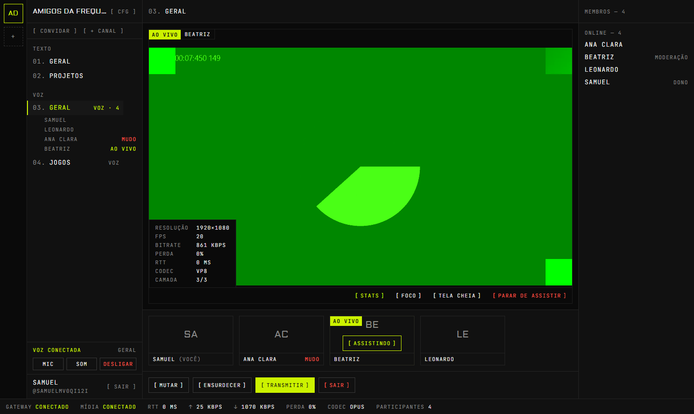
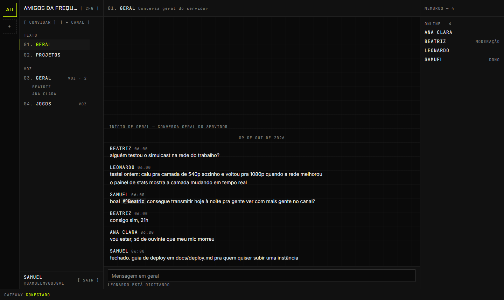
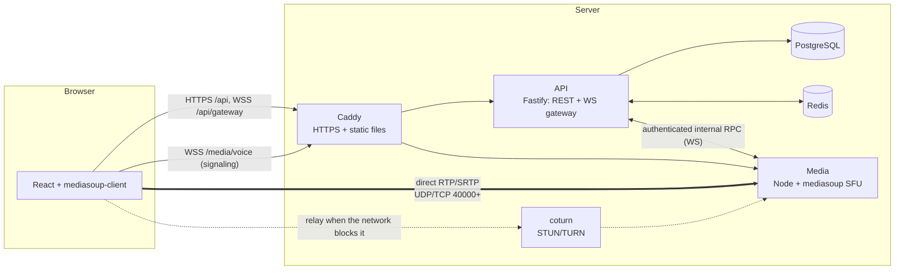
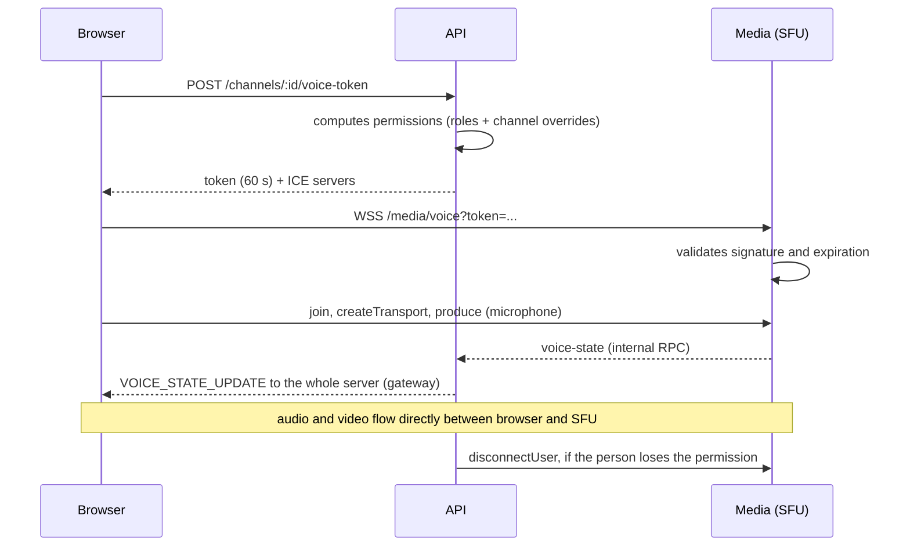

# Frequência

[Versão em português](README.md)

A Discord/TeamSpeak-style app for voice, screen sharing and text chat, with **all of the media and
realtime infrastructure implemented in the project itself**: an SFU built on mediasoup, a
WebSocket gateway with session resume and a signaling protocol typed end to end. No managed media
or realtime service (LiveKit, Agora, Twilio, Firebase etc.).

The interface is in Brazilian Portuguese, and so are the documents linked from this page.





## Features

- **Voice channels** routed by our own SFU: mute, deafen, speaking indicator, automatic
  reconnection, keyboard shortcuts.
- **Screen sharing** with 3-layer VP8 simulcast, presets (720p30, 1080p30, 1080p60), system audio
  when the browser provides it, several streams at once, focus mode and fullscreen.
- **Watch on demand**: video is only forwarded to those who clicked to watch, and the simulcast
  layer is chosen from the size at which the stream is displayed on each viewer's screen.
- **Servers, channels and categories**, invites with expiration and a usage limit.
- **Roles and permissions** as bitflags, with hierarchy and per-channel overrides, enforced on the
  server even during an ongoing call.
- **Text chat** with editing, deletion, mentions, cursor pagination and "typing".
- **Realtime gateway** in the style of Discord: heartbeat, sequence numbers and `resume`.
- **Observability**: Prometheus metrics and a panel of real statistics (`getStats`) in the
  interface.

## Demo

There is no public instance yet (deployment depends on a VM and a domain; the guide is in
[docs/deploy.md](docs/deploy.md)). To see it working, it takes two commands and no external
service — not even Docker is required:

```bash
pnpm install
pnpm dev        # http://localhost:5173
```

Open it in two windows (one of them incognito), create two accounts, create a server, generate an
invite and join the voice channel with both. The lab at `/lab` exercises the media layer in
isolation, without accounts: a peer-to-peer 1:1 call (`/lab/p2p`) and voice channels by nickname
(`/lab/voice`).

## Architecture



Three services, each with one responsibility:

| Service      | Does                                                                                    | Does not                   |
| ------------ | --------------------------------------------------------------------------------------- | -------------------------- |
| `apps/web`   | Interface, media capture and playback, gateway and signaling clients                    | Decide permissions         |
| `apps/api`   | Accounts, servers, permissions, chat, gateway, voice token issuance                     | Touch media                |
| `apps/media` | SFU: one Router per voice channel, transports, producers, consumers, speaking detection | Know users or the database |

The media service does not query the database and does not know what a role is. The API decides
whether someone may join a channel, and hands the browser a **60-second voice token** stating what
that person can do there (speak, stream). The media service only validates the signature:



More details in [docs/architecture.md](docs/architecture.md); the decisions and their alternatives
are in [docs/adr](docs/adr/README.md).

## Why an SFU and not a mesh

In a peer-to-peer mesh each participant sends their media to every other one. With _N_ people
that is _N − 1_ uploads per person and _N × (N − 1)_ connections in total: 4 people are already 12
streams, and a 1080p screen share for 7 viewers would require 7 encodings or 7 uploads of 3 Mbps
from the streamer's home. The home upload runs out before the sixth friend.

With an SFU (_Selective Forwarding Unit_) each person sends **once** to the server, which relays
the packets to whoever should receive them, without decoding anything. That changes three things:

1. **Each person's upload is constant**, no matter how many are in the channel.
2. **The server chooses what to forward.** That is what allows simulcast (each viewer receives the
   layer that fits their screen and their network), "watch on demand" and a deafen that actually
   saves bandwidth, because the audio stops being sent instead of just being silenced on the
   client.
3. **Rules are enforced on the server.** Muting pauses the producer in the SFU; losing the
   permission to stream drops the session. In a mesh, all of that would be a polite request to the
   client.

The price is having a media server to operate, and that is precisely the part this project sets
out to build. The 1:1 mesh call remains in the repository (`/lab/p2p`) as a reference and shares
the same protocol layer.

## Stack

| Layer    | Technology                                                                      |
| -------- | ------------------------------------------------------------------------------- |
| Monorepo | pnpm workspaces, Turborepo, TypeScript `strict`                                 |
| Web      | React 19, Vite, Tailwind 4, mediasoup-client, TanStack Query, Zustand           |
| API      | Fastify 5, `@fastify/websocket`, Zod, OpenAPI (`/docs`), Drizzle ORM            |
| Media    | Node, mediasoup 3 (C++ workers), `ws`                                           |
| Data     | PostgreSQL (SQL migrations), Redis (presence, voice state, pub/sub, rate limit) |
| Tests    | Vitest (unit and integration), Playwright (e2e), k6 (load)                      |
| Infra    | Docker, docker-compose, Caddy (automatic HTTPS), coturn, GitHub Actions         |

## Running it

Requirements: Node 22.12+ and pnpm 11. Docker is optional in development.

```bash
pnpm install
pnpm dev
```

`pnpm dev` starts Postgres and Redis (through `docker-compose.yml` if Docker is available;
otherwise, embedded instances with data in `.dev/`), applies the migrations and starts web (5173),
API (4000) and media (4100, plus the RTC ports from 40000 up) in watch mode.

| Command                          | What it does                                                       |
| -------------------------------- | ------------------------------------------------------------------ |
| `pnpm dev`                       | Full stack in development                                          |
| `pnpm dev:docker`                | Same, with the media service in a container                        |
| `pnpm check`                     | Lint, formatting, typecheck and tests                              |
| `pnpm e2e`                       | End-to-end tests (starts the stack itself)                         |
| `pnpm build && pnpm start:local` | Production builds running locally, without Docker                  |
| `pnpm prod:up`                   | Production with Docker: Caddy, API, media, Postgres, Redis, coturn |

Environment notes:

- **mediasoup on Windows:** the package ships the prebuilt worker, so the media service runs
  natively, without compiling anything. If the binary does not suit your machine, `pnpm dev:docker`
  runs just that service in a container.
- **Other devices on the local network:** the browser only grants the microphone in a secure
  context. Run with `DEV_HTTPS=1 pnpm dev` and open `https://<machine-ip>:5173`. The media service
  already announces the LAN IP in addition to `127.0.0.1`.
- **Configuration:** each app has a commented `.env.example`; nothing is required in development.

Production is one command after filling in `.env.prod` — step by step, ports and firewall in
[docs/deploy.md](docs/deploy.md).

## Tests

```
pnpm test    265 tests   permissions, RPC protocol, API (real Postgres and Redis),
                         SFU (real mediasoup workers), client reducers
pnpm e2e       8 tests   Chromium with synthetic camera, microphone and screen
```

The integration tests do not mock infrastructure. A few worth reading:

- [`apps/media/test/voice.test.ts`](apps/media/test/voice.test.ts) asks the mediasoup worker itself
  (`worker.dump()`) whether any router or transport is left after everyone leaves the channel.
- [`packages/shared/src/permissions.test.ts`](packages/shared/src/permissions.test.ts) covers the
  permission calculation: overrides, category inheritance, role hierarchy.
- [`apps/api/test/gateway.test.ts`](apps/api/test/gateway.test.ts) drops connections and checks
  that `resume` redelivers exactly what was lost, and starts two API instances to check event
  delivery between them through Redis.
- [`apps/web/e2e/app.spec.ts`](apps/web/e2e/app.spec.ts) goes through create account → create
  server → invite → join voice → stream, and removes permissions in the middle of the call.

## Load test

Measured on the production builds, on a single machine (Ryzen 7 5700G, 8 cores), with the load
generator on the same machine. Methodology, full tables and raw files in
[docs/load-test.md](docs/load-test.md).

| Scenario                                         | Result                                                               |
| ------------------------------------------------ | -------------------------------------------------------------------- |
| API, 200 virtual users, 168 req/s                | p95 of 34 ms, 0% errors, 0.8 core                                    |
| API, 500 virtual users                           | saturates: same throughput (161 req/s), p95 of 3.4 s                 |
| Gateway, 500 connections on one server, 10 msg/s | delivery with p95 of 26 ms, 6.5 thousand events/s, 0.44 core         |
| Voice + screen, 16 people, 1 stream in 1080p     | 255 consumers, mediasoup worker at 0.49 core                         |
| Voice + screen, 24 people                        | 391 consumers, worker at 0.58 core; the bottleneck was the generator |

The limit found is in the API, not in the SFU: one Node process recomputing the server state on
every request handles about 170 req/s on this hardware. The voice load test also found a real
defect, now fixed: when system audio capture failed, the whole stream was aborted instead of
carrying on with video only.

## Layout

```
apps/
  web/      React: features/{auth,gateway,guilds,chat,voice,app}, e2e/, load/
  api/      Fastify: modules/{auth,guilds,messages,voice}, gateway/, db/, drizzle/
  media/    mediasoup: rooms/{room,peer,room-manager}, signaling/{voice,internal}-server
packages/
  shared/   Zod schemas: RPC protocol, signaling, gateway, REST, permissions
deploy/     Caddyfile
docs/       architecture, deploy, load test, ADRs
load/       k6 scripts and raw results
scripts/    dev and local-production orchestration
```

## Known limitations

- A single instance of the media service. The internal RPC and the tokens were designed for
  several nodes, but there is no channel routing between media nodes.
- A voice channel lives in one worker (one core). Dozens of people in a channel fit comfortably;
  hundreds would require chaining routers (`pipeToRouter`).
- The gateway `resume` is local to the API instance (see
  [ADR 0006](docs/adr/0006-gateway-resume.md)).
- No recording, no camera in voice channels, no direct messages, no file uploads.

What still depends on manual validation or external infrastructure is in [ROADMAP.md](ROADMAP.md),
under "Pendências".

## License

[MIT](LICENSE).
