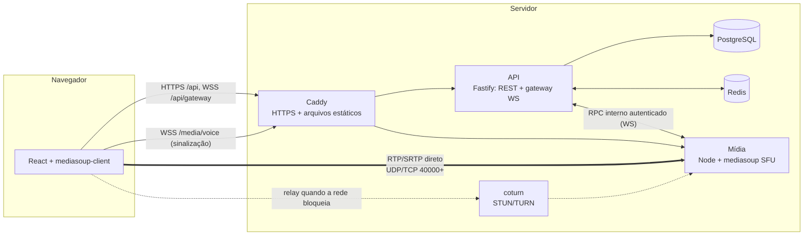
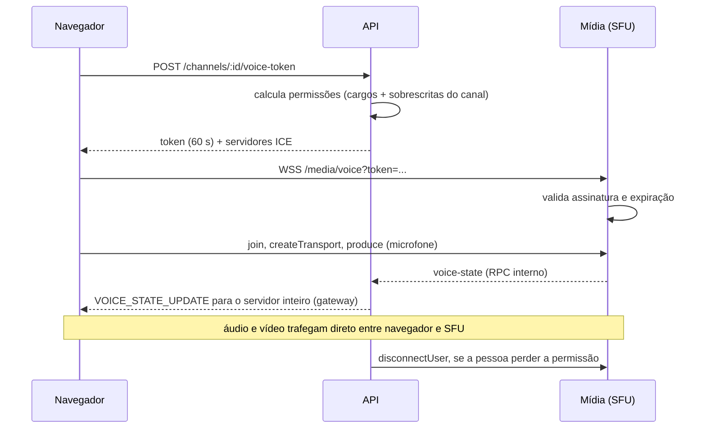

# Dispeaker

[English version](README.en.md)

App de voz, transmissão de tela e chat no estilo Discord/TeamSpeak, com **toda a infraestrutura de
mídia e tempo real implementada no próprio projeto**: um SFU construído sobre mediasoup, um
gateway WebSocket com retomada de sessão e um protocolo de sinalização tipado de ponta a ponta.
Nenhum serviço gerenciado de mídia ou de tempo real (LiveKit, Agora, Twilio, Firebase etc.).


## O que tem

- **Canais de voz** roteados por um SFU próprio: mutar, ensurdecer, indicador de quem está falando,
  reconexão automática, atalhos de teclado configuráveis, apertar para falar e volume individual
  por pessoa.
- **Supressão de ruído** com RNNoise rodando no navegador (WebAssembly), escolha de microfone,
  saída e câmera.
- **Câmera** em simulcast VP8, exibida no quadro de cada participante.
- **Transmissão de tela** com simulcast VP8 em 3 camadas, presets (720p30, 1080p30, 1080p60,
  1440p60 e resolução original até 4K), áudio do sistema quando o navegador entrega, várias
  transmissões ao mesmo tempo, modo foco, tela cheia e janela flutuante (picture-in-picture).
- **Assistir sob demanda**: o vídeo só é encaminhado para quem clicou em assistir, e a camada de
  simulcast é escolhida pelo tamanho em que a transmissão aparece na tela de cada espectador.
- **Servidores, canais e categorias**, convites com expiração e limite de usos; foto de perfil e
  ícone do servidor.
- **Cargos e permissões** em bitflags, com hierarquia e sobrescritas por canal, aplicadas no
  servidor inclusive durante uma chamada em andamento.
- **Chat de texto** com edição, exclusão, menções, paginação por cursor e "digitando"; emojis e
  imagens (PNG, JPEG, GIF, WebP) anexadas pelo botão, coladas ou arrastadas, guardadas em disco e
  servidas com as permissões do canal; reações, respostas, enquetes, tópicos, arquivos de qualquer tipo para download, prévias de
  links, mensagens não lidas por canal e, opcionalmente, busca de GIF. O chat também abre ao lado de uma chamada.
- **Menus de contexto** (clique direito ou toque longo) em canais, pessoas e mensagens.
- **Gateway em tempo real** no estilo Discord: heartbeat, números de sequência e `resume`.
- **Observabilidade**: métricas Prometheus e um painel de estatísticas reais (`getStats`) na
  interface.

## Demo

Ainda não há uma instância pública (o deploy depende de uma VM e de um domínio; o guia está em
[docs/deploy.md](docs/deploy.md)). Para ver funcionando, são dois comandos e nenhum serviço
externo — nem Docker é obrigatório:

```bash
pnpm install
pnpm dev        # http://localhost:5173
```

Abra em duas janelas (uma delas anônima), crie duas contas, crie um servidor, gere um convite e
entre no canal de voz com as duas. O laboratório em `/lab` exercita a camada de mídia isolada, sem
contas: chamada 1:1 ponto a ponto (`/lab/p2p`) e canais de voz por apelido (`/lab/voice`).

## Arquitetura



Três serviços, cada um com uma responsabilidade:

| Serviço      | Faz                                                                                 | Não faz                    |
| ------------ | ----------------------------------------------------------------------------------- | -------------------------- |
| `apps/web`   | Interface, captura e reprodução de mídia, clientes do gateway e da sinalização      | Decidir permissões         |
| `apps/api`   | Contas, servidores, permissões, chat, gateway, emissão de tokens de voz             | Tocar em mídia             |
| `apps/media` | SFU: um Router por canal de voz, transports, producers, consumers, detecção de fala | Conhecer usuários ou banco |

O serviço de mídia não consulta banco nem sabe o que é um cargo. Quem decide se alguém pode entrar
num canal é a API, que entrega ao navegador um **token de voz de 60 segundos** com o que aquela
pessoa pode fazer ali (falar, transmitir). O serviço de mídia só valida a assinatura:



Mais detalhes em [docs/architecture.md](docs/architecture.md); as decisões e suas alternativas
estão em [docs/adr](docs/adr/README.md).

## Por que SFU e não mesh

Numa malha ponto a ponto cada participante envia sua mídia para todos os outros. Com _N_ pessoas
são _N − 1_ uploads por pessoa e _N × (N − 1)_ conexões no total: 4 pessoas já são 12 fluxos, e
uma transmissão de tela em 1080p para 7 espectadores exigiria 7 codificações ou 7 uploads de
3 Mbps da casa de quem transmite. O upload doméstico acaba antes do sexto amigo.

Com um SFU (_Selective Forwarding Unit_) cada pessoa envia **uma vez** para o servidor, que
repassa os pacotes para quem deve receber, sem decodificar nada. Isso muda três coisas:

1. **O upload de cada um é constante**, não importa quantos estão no canal.
2. **O servidor escolhe o que encaminhar.** É isso que permite simulcast (cada espectador recebe a
   camada que cabe na sua tela e na sua rede), o "assistir sob demanda" e o ensurdecer que de fato
   economiza banda, porque o áudio para de ser enviado em vez de ser só silenciado no cliente.
3. **Regras são aplicadas no servidor.** Mutar pausa o producer no SFU; perder a permissão de
   transmitir derruba a sessão. Em mesh, tudo isso seria um pedido educado ao cliente.

O preço é ter um servidor de mídia para operar, e é justamente essa a parte que o projeto se
propõe a construir. A chamada 1:1 em mesh continua no repositório (`/lab/p2p`) como referência e
compartilha a mesma camada de protocolo.

## Stack

| Camada   | Tecnologia                                                                        |
| -------- | --------------------------------------------------------------------------------- |
| Monorepo | pnpm workspaces, Turborepo, TypeScript `strict`                                   |
| Web      | React 19, Vite, Tailwind 4, mediasoup-client, TanStack Query, Zustand             |
| API      | Fastify 5, `@fastify/websocket`, Zod, OpenAPI (`/docs`), Drizzle ORM              |
| Mídia    | Node, mediasoup 3 (workers em C++), `ws`                                          |
| Dados    | PostgreSQL (migrations SQL), Redis (presença, estado de voz, pub/sub, rate limit) |
| Testes   | Vitest (unitários e integração), Playwright (e2e), k6 (carga)                     |
| Infra    | Docker, docker-compose, Caddy (HTTPS automático), coturn, GitHub Actions          |

## Como rodar

Requisitos: Node 22.12+ e pnpm 11. Docker é opcional em desenvolvimento.

```bash
pnpm install
pnpm dev
```

`pnpm dev` sobe Postgres e Redis (pelo `docker-compose.yml` se houver Docker; senão, instâncias
embutidas com dados em `.dev/`), aplica as migrations e inicia web (5173), API (4000) e mídia
(4100, mais as portas RTC a partir de 40000) em modo watch.

| Comando                          | O que faz                                                       |
| -------------------------------- | --------------------------------------------------------------- |
| `pnpm dev`                       | Stack completo em desenvolvimento                               |
| `pnpm dev:docker`                | Igual, com o serviço de mídia em container                      |
| `pnpm check`                     | Lint, formatação, typecheck e testes                            |
| `pnpm e2e`                       | Testes ponta a ponta (sobe o stack sozinho)                     |
| `pnpm build && pnpm start:local` | Builds de produção rodando localmente, sem Docker               |
| `pnpm prod:up`                   | Produção com Docker: Caddy, API, mídia, Postgres, Redis, coturn |

Notas de ambiente:

- **mediasoup no Windows:** o pacote traz o worker pré-compilado, então o serviço de mídia roda
  nativo, sem compilar nada. Se o binário não servir para a sua máquina, `pnpm dev:docker` roda só
  ele em container.
- **Outros dispositivos na rede local:** o navegador só libera microfone em contexto seguro. Rode
  com `DEV_HTTPS=1 pnpm dev` e abra `https://<ip-da-máquina>:5173`. O serviço de mídia já anuncia
  o IP da LAN além do `127.0.0.1`.
- **Configuração:** cada app tem um `.env.example` comentado; nada é obrigatório em
  desenvolvimento.

Produção é um comando depois de preencher `.env.prod` — passo a passo, portas e firewall em
[docs/deploy.md](docs/deploy.md).

## Testes

```
pnpm test    265 testes   permissões, protocolo RPC, API (Postgres e Redis reais),
                          SFU (workers mediasoup reais), reducers do cliente
pnpm e2e       8 testes   Chromium com câmera, microfone e tela sintéticos
```

Os testes de integração não usam mocks de infraestrutura. Alguns que valem a leitura:

- [`apps/media/test/voice.test.ts`](apps/media/test/voice.test.ts) pergunta ao próprio worker do
  mediasoup (`worker.dump()`) se sobrou algum router ou transport depois que todos saem do canal.
- [`packages/shared/src/permissions.test.ts`](packages/shared/src/permissions.test.ts) cobre o
  cálculo de permissões: sobrescritas, herança de categoria, hierarquia de cargos.
- [`apps/api/test/gateway.test.ts`](apps/api/test/gateway.test.ts) derruba conexões e verifica que
  o `resume` reentrega exatamente o que foi perdido, e sobe duas instâncias da API para conferir a
  entrega de eventos entre elas pelo Redis.
- [`apps/web/e2e/app.spec.ts`](apps/web/e2e/app.spec.ts) percorre criar conta → criar servidor →
  convidar → entrar na voz → transmitir, e tira permissões no meio da chamada.

## Teste de carga

Medido nos builds de produção, numa única máquina (Ryzen 7 5700G, 8 núcleos), com o gerador de
carga na mesma máquina. Metodologia, tabelas completas e arquivos brutos em
[docs/load-test.md](docs/load-test.md).

| Cenário                                        | Resultado                                                     |
| ---------------------------------------------- | ------------------------------------------------------------- |
| API, 200 usuários virtuais, 168 req/s          | p95 de 34 ms, 0% de erros, 0,8 núcleo                         |
| API, 500 usuários virtuais                     | satura: mesma vazão (161 req/s), p95 de 3,4 s                 |
| Gateway, 500 conexões num servidor, 10 msg/s   | entrega com p95 de 26 ms, 6,5 mil eventos/s, 0,44 núcleo      |
| Voz + tela, 16 pessoas, 1 transmissão em 1080p | 255 consumers, worker do mediasoup em 0,49 núcleo             |
| Voz + tela, 24 pessoas                         | 391 consumers, worker em 0,58 núcleo; o gargalo foi o gerador |

O limite encontrado está na API, não no SFU: um processo Node recalculando o estado do servidor a
cada requisição segura cerca de 170 req/s neste hardware. O teste de carga de voz também achou um
defeito real, corrigido: quando a captura do áudio do sistema falhava, a transmissão inteira era
abortada em vez de seguir só com vídeo.

## Estrutura

```
apps/
  web/      React: features/{auth,gateway,guilds,chat,voice,app}, e2e/, load/
  api/      Fastify: modules/{auth,guilds,messages,voice}, gateway/, db/, drizzle/
  media/    mediasoup: rooms/{room,peer,room-manager}, signaling/{voice,internal}-server
packages/
  shared/   schemas Zod: protocolo RPC, sinalização, gateway, REST, permissões
deploy/     Caddyfile
docs/       arquitetura, deploy, teste de carga, ADRs
load/       scripts k6 e resultados brutos
scripts/    orquestração de dev e de produção local
```

## Limitações conhecidas

- Uma instância do serviço de mídia. O RPC interno e os tokens foram desenhados para vários nós,
  mas não há roteamento de canais entre nós de mídia.
- Um canal de voz vive em um worker (um núcleo). Dezenas de pessoas num canal cabem com folga;
  centenas exigiriam encadear routers (`pipeToRouter`).
- O `resume` do gateway é local à instância da API (ver [ADR 0006](docs/adr/0006-gateway-resume.md)).
- Sem gravação, sem câmera nos canais de voz, sem mensagens diretas, sem upload de arquivos.

O que ainda depende de validação manual ou de infraestrutura externa está em
[ROADMAP.md](ROADMAP.md), na seção "Pendências".

## Licença

[MIT](LICENSE).
