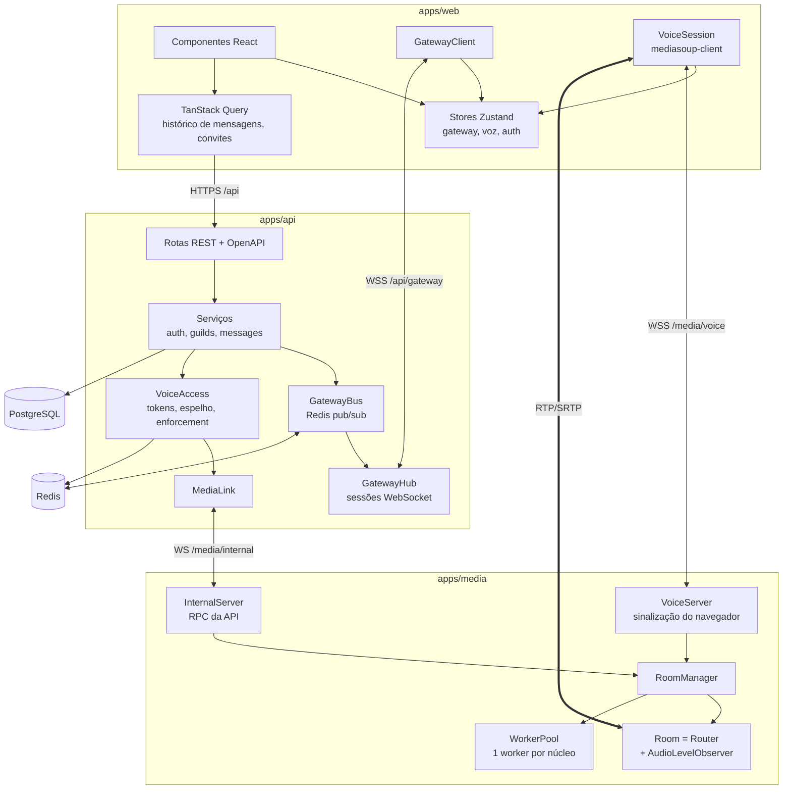
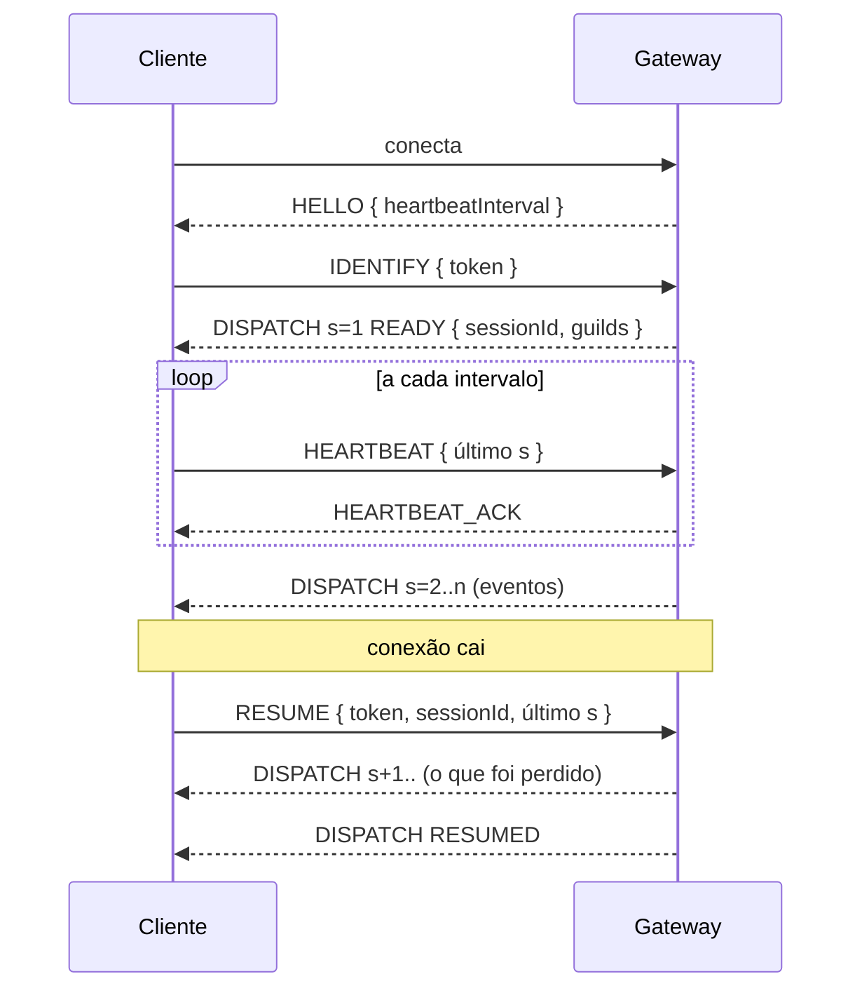

# Arquitetura

Visão de como as partes se encaixam. O porquê de cada escolha está nos [ADRs](adr/README.md).

## Serviços e fronteiras



Regras que mantêm as fronteiras limpas:

- **Toda mensagem que cruza um processo é validada por um schema Zod de `packages/shared`**: corpo
  HTTP, frame de WebSocket, RPC interno. Os tipos TypeScript são inferidos desses schemas; cliente
  e servidor não conseguem divergir sem quebrar o build.
- **O serviço de mídia não conhece o domínio.** Ele recebe um token assinado dizendo "usuário X
  pode entrar na sala Y e pode falar/transmitir" e reporta quem está em cada sala. Não lê o banco.
- **A API não toca em mídia.** Ela decide e ordena (`disconnectUser`, `closeRoom`); a execução é do
  serviço de mídia.
- **O navegador fala só com a própria origem.** Vite em desenvolvimento e Caddy em produção
  encaminham `/api` e `/media`; não há CORS nem cookies entre domínios.

## Um protocolo, três canais

`packages/shared/src/rpc` define um ponto de comunicação (`RpcPeer`) independente de transporte:
requisições com resposta, eventos sem resposta, tudo validado na entrada e na saída. Cada lado
declara o que aceita:

```ts
export const voiceServerSide = defineSide({
  requests: {
    produce: { request: z.object({ transportId, kind, rtpParameters, source }), response: ... },
    // ...
  },
  events: {},
});
```

O mesmo `RpcPeer` carrega:

| Canal                 | Entre             | Definição            |
| --------------------- | ----------------- | -------------------- |
| Sinalização P2P (lab) | navegador ↔ API   | `signaling/p2p.ts`   |
| Sinalização de voz    | navegador ↔ mídia | `signaling/voice.ts` |
| RPC interno           | API ↔ mídia       | `internal.ts`        |

O gateway usa um formato próprio (`{ op, d, s, t }`, em `gateway.ts`) porque suas necessidades são
outras: eventos numerados em sequência e retomada, não requisição/resposta.

## Mídia

### Workers, routers e portas

Um worker do mediasoup é um processo C++ de uma thread. O `WorkerPool` cria um por núcleo; cada
canal de voz vira um `Router` no worker com menos routers no momento. Cada worker tem um
`WebRtcServer`, de modo que **todos os transports daquele worker compartilham uma porta UDP e uma
TCP fixas**. A faixa de portas é `workers × endereços anunciados` (16 por padrão em produção), não
milhares.

`RTC_ANNOUNCED_ADDRESSES` aceita vários endereços. Em desenvolvimento, sem configuração, o serviço
anuncia `127.0.0.1` e o primeiro IPv4 da LAN, e por isso funciona tanto na própria máquina quanto
em outro dispositivo da rede.

### Ciclo de vida

Todo objeto do mediasoup pertence a exatamente um `Peer`, e todo `Peer` a uma `Room`. Fechar o
dono fecha tudo que ele possui; sair do canal é `room.removePeer(peer)` e nada mais. Quando a
última pessoa sai, o router é fechado.

O que escaparia disso é pego por um mecanismo específico:

| Situação                                  | Mecanismo                                             |
| ----------------------------------------- | ----------------------------------------------------- |
| Aba fechada sem avisar                    | Fechamento do WebSocket remove o peer                 |
| Cliente travado, socket aberto            | Heartbeat ping/pong; dois perdidos encerram a conexão |
| Socket conectou e nunca entrou na sala    | Timeout de `join` (10 s)                              |
| Transport criado e nunca conectado (DTLS) | Timeout de conexão (30 s) e aviso ao cliente          |
| ICE desconectado e não recuperado         | Tolerância de 15 s, depois o transport é fechado      |
| Mesma pessoa entra de novo (reconexão)    | A sessão nova substitui a antiga (código 4002)        |

O teste de liberação de recursos consulta o próprio worker (`worker.dump()`,
`webRtcServer.dump()`), não as estruturas do Node.

### Áudio

Opus com FEC in-band e DTX. O `AudioLevelObserver` do router reporta a cada 200 ms quem passou do
limiar; a sala só emite `speaking` quando o conjunto muda.

Mutar e ensurdecer são estado do servidor. Mutar pausa o producer no SFU. Ensurdecer pausa todos
os consumers de áudio daquela pessoa — a banda deixa de ser gasta — e implica mutar, como no
Discord.

### Transmissão de tela

- Publicada como simulcast: três codificações da mesma captura (1/4, 1/2 e resolução cheia). A
  exceção é o preset FILME, com uma única codificação em resolução cheia para todo mundo.
- O codec é escolhido por quem transmite (`video-codec.ts`): H.264 High quando a placa de vídeo
  codifica (`mediaCapabilities` responde `powerEfficient`), VP8 nos demais casos. Câmeras usam VP8.
- Entrar num canal consome apenas microfones. O consumer de uma transmissão só é criado quando a
  pessoa clica em assistir, e é fechado quando ela para.
- Cada tile mede sua altura com um `ResizeObserver` e pede a camada correspondente
  (`setConsumerLayers`). Uma miniatura recebe a camada de 270p; a mesma transmissão em foco, 1080p.
- O painel de estatísticas lê `getStats()` do consumer (ou do producer, para quem transmite):
  resolução, fps, bitrate, perda, codec e a camada em uso.

### Reconexão do cliente

`VoiceSession` trata três níveis de falha:

1. ICE `disconnected` por mais de 4 s ou `failed`: reinício de ICE no mesmo transport.
2. Socket de sinalização caiu ou o servidor fechou um transport: reconstrói tudo com backoff. O
   servidor substitui a sessão anterior; microfone, transmissão e streams assistidas são retomados.
3. Código de fechamento definitivo (expulso, substituído por outra aba, sala fechada): encerra e
   mostra o motivo. `4006` (permissões mudaram) é o oposto: reconecta para buscar um token novo.

## API

### Autenticação

- Senhas com argon2id.
- Access token JWT de 15 minutos, mantido só em memória no navegador.
- Refresh token opaco em cookie `httpOnly`, `SameSite=Strict`, restrito a `/api/auth`. No banco fica
  apenas o SHA-256 dele.
- Rotação a cada uso. Um refresh token já rotacionado que reaparece é tratado como roubo e revoga
  a família inteira (com 10 s de tolerância para duas abas renovando ao mesmo tempo).
- Logout grava a família numa lista de negação no Redis pelo tempo de vida do access token, e
  derruba as conexões de gateway daquela sessão.

### Permissões

Bitflags (`packages/shared/src/permissions.ts`), calculadas pela mesma função no servidor e no
cliente — o cliente para decidir o que mostrar, o servidor para decidir de fato.

1. Dono do servidor: tudo.
2. Base = `@everyone` OR todos os cargos do membro. Com `Administrator`: tudo.
3. Sobrescritas da categoria, depois as do canal. Em cada camada: `@everyone`, depois cargos (todas
   as negações, depois todas as permissões), depois o membro.
4. Regras implícitas: sem `ViewChannel` não há permissão alguma no canal; sem `Connect` não há
   `Speak` nem `Stream`.

A hierarquia limita quem age sobre quem: só se edita ou atribui cargo abaixo do próprio cargo mais
alto, só se expulsa quem tem cargo mais baixo, e ninguém concede uma permissão que não possui.

Canais que a pessoa não pode ver não existem para ela: não vêm no payload do servidor, e a API
responde 404 (não 403) a qualquer operação sobre eles.

### Gateway



- Cada sessão guarda os últimos 500 eventos. A sessão sobrevive 60 s sem socket, à espera de um
  `resume`; a presença só vira offline depois disso, o que evita piscar a cada troca de rede.
- Quem trata uma requisição REST publica o evento no Redis; todas as instâncias entregam aos
  sockets que têm. Eventos de canal são filtrados por quem pode ver o canal.
- Mudanças que alteram permissões (cargos, sobrescritas, cargos de um membro) não tentam calcular
  o que mudou para cada pessoa: disparam um `GUILD_SYNC`, que reenvia o servidor como cada membro
  passa a enxergá-lo.

### Estado de voz

O serviço de mídia é a fonte da verdade sobre quem está em cada canal. A API mantém um espelho no
Redis, alimentado pelos eventos `voice-state` do RPC interno:

- Cada evento tem um id único; com várias instâncias da API conectadas, só a primeira a reivindicá-lo
  (`SET NX`) o processa.
- Ao (re)conectar, a API pede um snapshot e reconcilia o espelho.
- Depois de qualquer mudança de permissão, `VoiceAccess.enforce` revê quem está em voz naquele
  servidor: sem `Connect`, a pessoa é desconectada; se `Speak`/`Stream` mudaram, é forçada a
  reentrar para receber um token com os direitos novos.

### Reuniões

Chamadas por link fora de qualquer servidor, que somem quando a chamada acaba (ADR 0017). Tudo
fica no Redis (`meeting:<id>*`); a chamada é a sala `meet:<id>` do serviço de mídia, e os
eventos `voice-state` dessas salas vão para `MeetingService` em vez do espelho de voz. Sala de
espera e chat chegam por um WebSocket próprio de cada reunião, com fan-out por Redis pub/sub.

## Dados

PostgreSQL guarda o que é durável (usuários, sessões, servidores, canais, cargos, sobrescritas,
convites, mensagens). As migrations são SQL gerado pelo Drizzle Kit, versionadas em
`apps/api/drizzle` e aplicadas na inicialização.

Ids são UUIDv7: ordenáveis por tempo. O id da mensagem é o cursor de paginação, e a página de
histórico é uma varredura de um único índice `(channel_id, id DESC)`.

Redis guarda o que pode ser reconstruído: presença, espelho do estado de voz, contadores de rate
limit, lista de negação de sessões e o canal de pub/sub. Em produção roda sem persistência.

## Observabilidade

- `GET /metrics` na API (fora de `/api`, logo não é exposto pelo Caddy): conexões e usuários no
  gateway, latência HTTP por rota, e os números do serviço de mídia lidos pelo RPC interno —
  canais de voz ativos, participantes, producers, consumers e CPU de cada worker.
- `GET /media/metrics` e `GET /media/stats` no serviço de mídia, protegidos pelo segredo
  compartilhado fora de desenvolvimento. `stats` lista salas, peers, producers e consumers e é o
  que os testes e2e usam para verificar o que o servidor realmente encaminha.
- Na interface, a barra de sistema mostra estado do gateway e da mídia, RTT, bitrate, perda e
  codec da conexão de voz.
